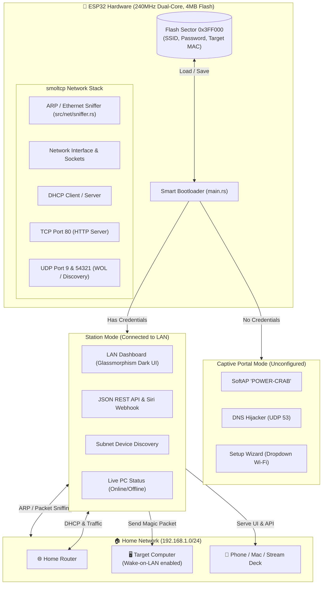

# 🦀 Power-Crab

[](https://www.rust-lang.org/)
[](https://www.espressif.com/)
[](LICENSE)
[](https://github.com/esp-rs/esp-hal)
[](https://github.com/smoltcp-rs/smoltcp)

**Power-Crab** is an ultra-fast, bare-metal (`#![no_std]`) Rust firmware for the ESP32 that transforms low-cost microcontrollers into a dedicated, offline-first **Wake-on-LAN (WOL) Smart Appliance & Local Power Gateway**.

It features automated **Captive Portal Wi-Fi setup**, **LAN Device Discovery (ARP/Ethernet Sniffer)** to select target computers without typing MAC addresses, a **Live PC Status monitor (Online / Offline / Waking up)**, a modern **Dark-Mode Web Dashboard**, and an instantaneous **REST API / Siri Webhook** — operating 100% within your private home network without external cloud, internet, or domain dependencies.

---

## ✨ Features

- **🦀 Pure Bare-Metal Rust (`no_std`)**: Built on `esp-hal` (v0.23) and `smoltcp` (v0.12). Zero C runtime overhead, sub-second boot times, and compiles in ~2 seconds.
- **🔍 Auto LAN Device Discovery (Zero-Manual MAC)**:
  - Transparent Ethernet/ARP packet sniffer built into the PHY network layer.
  - Automatically identifies active IP and MAC addresses across your local subnet.
  - Interactive Web UI: Click **"👉 Use Target"** next to your computer to save its MAC address to Flash memory instantly.
- **🟢 Live PC Status Indicator**:
  - Real-time online/offline monitoring via Ethernet frame timing detection.
  - Visual status badges: 🔴 **PC Offline** (Sleeping), 🟡 **Waking up...** (Pulsing animation during boot), 🟢 **PC Online**.
- **⚡ RFC-Compliant Wake-on-LAN Engine**:
  - Crafts raw 102-byte Magic Packets (`0xFF` × 6 + `MAC` × 16).
  - Broadcasts across local subnet over UDP Port 9.
- **📱 Zero-Touch Captive Portal (`POWER-CRAB`)**:
  - Pops up automatic Wi-Fi setup wizard on iOS, Android, macOS, and Windows.
  - Built-in RFC 2131 DHCP Server (UDP 67) & DNS Hijacker (UDP 53).
  - Dynamic 2.4GHz Wi-Fi scanning with dropdown selector.
- **🌐 Responsive LAN Web Dashboard**:
  - Dark-mode glassmorphism UI served on port 80.
  - Big prominent **⚡ WAKE UP PC** button.
  - Dynamic 2.4GHz Wi-Fi scanner dropdown in the admin settings.
  - Fully compliant with Chrome & Brave **Private Network Access (PNA)** and CORS preflight (`OPTIONS`).
- **📲 Siri Shortcuts, Apple Watch & Webhook Ready**:
  - Instant trigger via `GET /wake` or `POST /api/wake`.
  - One-click copyable shortcut URL for iOS Shortcuts (*"Hey Siri, turn on my PC"*), Stream Deck, or Home Assistant.
- **🔐 Protected Admin Controls**:
  - Changing Wi-Fi credentials or triggering a factory reset requires the admin password (default: `pwd_1234`, configurable in code).
- **💾 Flash Memory Persistence (V2 Format)**:
  - Stores Wi-Fi credentials and target MAC in NOR Flash sector `0x3FF000` with magic header verification and XOR checksums. Survives power cuts and reboots.
- **🔒 100% Private & Offline**:
  - Operates purely within your local network (`192.168.x.x`). No external domain, public DNS, or cloud service required.

---

## 🏗️ Architecture



---

## 📡 REST API Reference

Power-Crab provides a fast, lightweight JSON REST API on port 80:

| Method | Endpoint | Description | Auth Required |
|---|---|---|---|
| `POST` | `/api/wake` | Broadcasts WOL Magic packet to configured target MAC | No |
| `GET` | `/wake` | Quick trigger endpoint (ideal for browser bookmarks & Siri) | No |
| `GET` | `/api/status` | Returns target PC online/offline status & last seen seconds | No |
| `GET` | `/api/devices` | Returns list of discovered LAN devices (`ip`, `mac`, `ago`) | No |
| `POST` | `/api/scan-lan` | Dispatches active subnet sweep to discover new hosts | No |
| `GET` | `/api/wifi/scan` | Scans nearby 2.4GHz Wi-Fi networks and signal strengths | No |
| `POST` | `/api/config` | Updates the target computer MAC address in Flash | No |
| `POST` | `/api/wifi` | Updates Wi-Fi credentials and reboots board | **Admin** (required) |
| `POST` | `/api/reset` | Erases Flash and restarts into Captive Portal mode | **Admin** (required) |

---

### Example API Requests

#### 1. Wake Target PC
```bash
curl -X POST http://<ESP32_IP>/api/wake
# or simply:
curl http://<ESP32_IP>/wake
```
**Response:**
```json
{
  "status": "ok",
  "message": "Magic packet sent",
  "mac": "AA:BB:CC:DD:EE:FF"
}
```

#### 2. Check Live PC Online Status
```bash
curl http://<ESP32_IP>/api/status
```
**Response:**
```json
{
  "online": true,
  "last_seen_sec": 4
}
```

#### 3. List Discovered LAN Devices
```bash
curl http://<ESP32_IP>/api/devices
```
**Response:**
```json
[
  { "ip": "192.168.1.1", "mac": "00:11:22:33:44:55", "ago": 5 },
  { "ip": "192.168.1.102", "mac": "AA:BB:CC:DD:EE:01", "ago": 3 },
  { "ip": "192.168.1.111", "mac": "AA:BB:CC:DD:EE:02", "ago": 0 }
]
```

#### 4. Scan Nearby Wi-Fi Networks
```bash
curl http://<ESP32_IP>/api/wifi/scan
```
**Response:**
```json
[
  { "ssid": "Home_WiFi_2.4G", "rssi": -42 },
  { "ssid": "Office_Network", "rssi": -65 }
]
```

#### 5. Save Target PC MAC Address
```bash
curl -X POST http://<ESP32_IP>/api/config -d "mac=AA:BB:CC:DD:EE:FF"
```

#### 6. Change Wi-Fi (Protected)
```bash
curl -X POST http://<ESP32_IP>/api/wifi \
  -d "admin=pwd_1234&ssid=NewHomeWiFi&password=SecretPassword123"
```

---

## 📲 Remote Access from Outside Home (Tailscale)

Power-Crab is an offline appliance designed for internal LAN networks, so you **do not need a public domain or port forwarding**.

To access Power-Crab from outside your home securely:
1. Run a **Tailscale Subnet Router** on any computer inside your home (e.g. Windows PC, Mac, Raspberry Pi, or Apple TV):
   ```bash
   tailscale up --advertise-routes=192.168.1.0/24
   ```
2. Enable the subnet route in your [Tailscale Admin Console](https://login.tailscale.com/admin/machines).
3. Now, whenever your smartphone or laptop has Tailscale connected anywhere in the world, you can directly access `http://<ESP32_IP>` and wake your PC remotely!

---

## 🚀 Getting Started

### Hardware Requirements
- **Board**: Any standard ESP32 development board (e.g., ESP32-WROOM-32, NodeMCU ESP32, ESP32-D0WD-V3)
- **Power**: 5V via Micro-USB / USB-C
- **Target PC**: Motherboard with Wake-on-LAN (WOL) enabled in BIOS/UEFI and network adapter settings.

### Prerequisites

1. **Rust Toolchain with Xtensa Support**: Install via [`espup`](https://github.com/esp-rs/espup):
   ```bash
   cargo install espup
   espup install
   source "$HOME/export-esp.sh"
   ```
2. **Flash Tool**:
   ```bash
   cargo install espflash
   ```

### Building & Flashing

```bash
# 1. Clone the repository
git clone git@github.com:134NKns/Power-Crab.git
cd Power-Crab

# 2. Source the Espressif toolchain environment
source ~/export-esp.sh

# 3. Check and build release binary
cargo +esp build --release

# 4. Flash to ESP32 (replace /dev/ttyUSB0 or COM port with yours)
espflash flash target/xtensa-esp32-none-elf/release/power-crab --port /dev/ttyUSB0 --monitor
```

---

## 📁 Project Structure

```
Power-Crab/
├── src/
│   ├── lib.rs              # Module root and re-exports
│   ├── main.rs             # Boot orchestrator (< 65 lines)
│   │
│   ├── traits/             # Abstraction interfaces
│   │   └── storage.rs      # WifiStorage trait
│   │
│   ├── storage/            # NOR Flash persistence (Sector 0x3FF000)
│   │   ├── creds.rs        # WifiCredentials struct (SSID, Password, Target MAC)
│   │   └── flash.rs        # NOR Flash driver with XOR checksums
│   │
│   ├── wol/                # Wake-on-LAN subsystem
│   │   ├── packet.rs       # 102-byte Magic packet generator & MAC parser
│   │   └── mod.rs          # WOL module definitions
│   │
│   ├── portal/             # Captive Portal subsystem (Provisioning mode)
│   │   ├── dhcp.rs         # RFC 2131 DHCP server (UDP 67)
│   │   ├── dns.rs          # DNS hijacker (UDP 53)
│   │   ├── web.rs          # Setup wizard HTML & parser (TCP 80)
│   │   └── mod.rs          # Portal coordinator
│   │
│   ├── station/            # Station Mode subsystem (Home LAN operation)
│   │   ├── web.rs          # LAN Web Dashboard HTML & REST API parser
│   │   └── mod.rs          # HTTP server, DHCP client & WOL coordinator
│   │
│   └── net/                # Network utilities & packet inspection
│       ├── sniffer.rs      # Passive & active Ethernet/ARP device sniffer
│       ├── time.rs         # Monotonic clock for smoltcp
│       └── mod.rs          # Net module exports
│
├── scripts/
│   ├── flash.sh            # One-click build and flash script
│   └── monitor.sh          # Serial monitor script
│
├── Cargo.toml              # Dependencies & compiler profiles
└── LICENSE                 # MIT License
```

---

## 📄 License

This project is open-source and licensed under the [MIT License](LICENSE). Contributions, bug reports, and feature requests are welcome!
